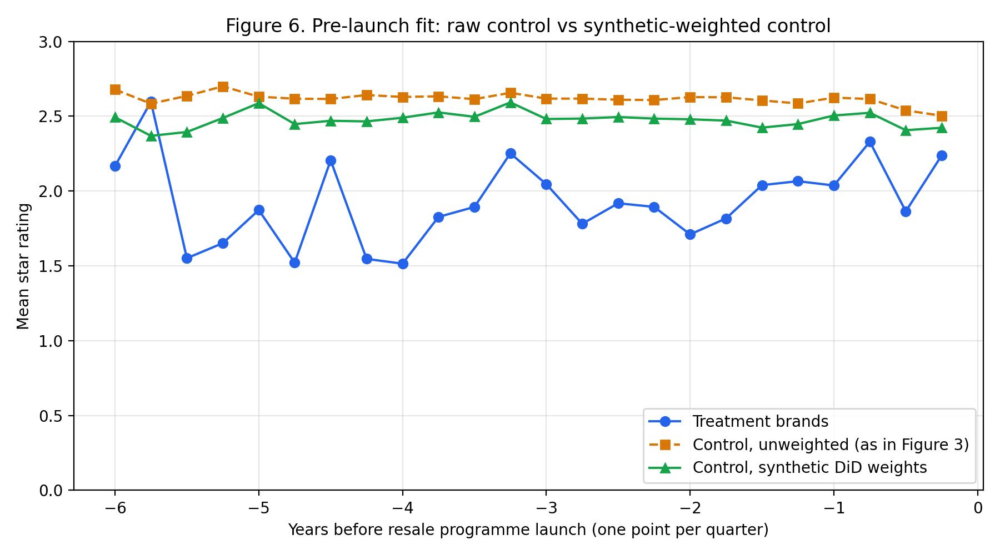

# Consumer Perceptions of Branded Resale Channels

**The Role of Design Features in Balancing Sustainability and Value**

Master thesis by Vera Gak Anagrova. MSc Economics and Business, Data Science and Marketing Analytics, Erasmus University Rotterdam, July 2026. Supervisor: Dr. Michiel Van Crombrugge.

📄 **[Read the full thesis (PDF)](thesis/Master_Thesis_Vera_Gak_Anagrova.pdf)**

This repository contains the data and code behind every table and figure in the thesis, from scraping the reviews to the final estimates.

### Skills shown

| Area | What was done |
|---|---|
| Data collection | Scraped 49,736 Trustpilot reviews of 48 brands with Python and Selenium |
| NLP | Built a sustainability dictionary, measured value sentiment with VADER, and ran LDA topic modelling |
| Causal inference | Difference-in-differences with TWFE, Callaway & Sant'Anna for staggered adoption, and synthetic DiD |
| Statistics | Robust (HC1) regression, placebo and bootstrap inference, sensitivity and robustness checks |
| Reproducibility | Numbered R and Python pipeline, documented data, and an automatic check against the thesis |

## The question

More and more fashion brands sell their own second-hand products next to new ones: Sandro Seconde Main, Ba&sh Second Hand, Patagonia Worn Wear. The industry presents this as a low-risk sustainability signal. This thesis asks two questions:

1. When a brand launches its own resale channel, do customers see it differently afterwards, in their ratings, in how they talk about sustainability, and in how they talk about price and value?
2. Do the design choices of the resale channel explain why some brands gain and others lose? The four choices are how integrated it is with the main shop, how strongly it is framed as sustainability, how deep the discount is, and which extra services it offers.

## Data

49,736 unsolicited Trustpilot reviews of 48 fashion and outdoor brands, written between 2011 and 2026:

- **21 treatment brands** run their own resale programme, through Trove, Faume or Archive. 19 have enough reviews before the launch to be used.
- **27 control brands** are in the same segments but have no resale programme.

Each review gets three outcome measures:

- **Star rating**, from 1 to 5.
- **Sustainability score**: dictionary matches for terms like *recycle*, *circular* and *second-hand*, minus matches for greenwashing scepticism.
- **Value VADER**: sentiment of the sentences that talk about price, quality or value.

See [`data/README.md`](data/README.md) for the codebook. Review text is not published. Everything except the topic model can be reproduced without it.

## Method

| Study | Unit | Method | Thesis section |
|---|---|---|---|
| Preliminary | Review | LDA topic model, to check what reviews talk about | 4.3.1, 5.1 |
| Study 1 | Review for TWFE, brand x quarter for the others | Difference-in-differences with three estimators: TWFE, Callaway & Sant'Anna, and **synthetic DiD**, the main one | 4.3.2, 5.2 |
| Study 2 | Brand, N = 19 | OLS of each brand's synthetic DiD effect on the four design variables, HC1 standard errors | 4.3.3, 5.3 |

Synthetic DiD is the main estimator because the control brands start from a different baseline than the treatment brands. Before launch they have higher ratings and more sustainability talk. A plain DiD compares the two groups as they are. Synthetic DiD reweights the controls separately for each treatment brand, so they track that brand's own pre-launch path.

## Main findings

| Outcome | TWFE | Callaway & Sant'Anna | **Synthetic DiD** |
|---|---|---|---|
| Star rating | +0.244, p = 0.301 | -0.337, p = 0.225 | **-0.078, p = 0.419** |
| Sustainability score | +0.005, p = 0.822 | -0.014, p = 0.427 | **-0.018, p = 0.052** |
| Value VADER | +0.022, p = 0.680 | -0.052, p = 0.328 | **-0.103, p = 0.002** |

*Table 3 of the thesis. Average effect of a resale launch across the 19 treatment brands.*

- **All three synthetic DiD effects are negative.** The clearest one is in how customers write about price and value. Once the controls are reweighted, a positive, non-significant TWFE estimate becomes negative and significant.
- **Effects differ by segment.** Outdoor and athletic brands lose on all three outcomes. Contemporary fashion brands gain on rating but lose on sustainability language. Premium fashion gains on sustainability language. See Table 4.
- **Effects differ a lot by brand.** Rating effects range from -1.83 for Lululemon to +1.40 for Armedangels. See Figure 4 and Table 5.
- **Design choices do not explain the differences one by one.** With 19 brands, no design variable is significant in Table 6. One pattern holds: integration and sustainability messaging act as substitutes for sustainability perception. Their interaction is negative and significant in Table 7. The thesis treats this as suggestive.

<p align="center">
  
</p>

*Effect of the resale launch on each brand's star rating. Dark bars are significant at 5%. The average hides large differences between brands.*

<p align="center">
  
</p>

*Why synthetic DiD: before launch, treatment brands (blue) are rated well below the control brands (orange). Reweighting the controls (green) moves them closer.*

## Where every result comes from

| Thesis | Script | Output in `results/` |
|---|---|---|
| Table 1: treatment sample | `code/10_descriptives.R` | `tables/table1_treatment_sample.csv` |
| Table 2: outcomes by group and period | `code/10_descriptives.R` | `tables/table2_descriptives.csv` |
| Figure 1: pre vs post outcomes | `code/11_figures_descriptive.py` | `figures/figure1_before_after.jpg` |
| Figure 2: LDA topics | `code/04_lda_topics.py`, needs review text | `figures/figure2_lda_topics.jpg` |
| Figure 3: rating by event time | `code/25_figures_synthdid.py` | `figures/figure3_event_time_rating.jpg` |
| Table 3: three estimators | `code/20`, `21`, `23`, `26` | `tables/tableA6_twfe.csv`, `table3_callaway_santanna.csv`, `table3_synthdid_pooled_thesis_se.csv` |
| Figure 4: synthetic DiD by brand | `code/23_synthdid.R` + `25_figures_synthdid.py` | `figures/figure4_synthdid_by_brand.jpg` |
| Figure 5: C&S event study | `code/22_cs_event_study.R` | `figures/figure5_cs_event_study_rating.jpg` |
| Figure 6: pre-launch fit | `code/23_synthdid.R` + `25_figures_synthdid.py` | `figures/figure6_pretrend_fit.jpg` |
| Table 4: synthetic DiD by segment | `code/23_synthdid.R` + `26` | `tables/table4_synthdid_by_segment_thesis_se.csv` |
| Table 5: brand-level changes | `code/31_study2_raw_change.R` | `tables/table5_brand_level.csv` |
| Table 6: moderation | `code/30_study2_moderation.R` | `tables/table6_moderation.csv` |
| Table 7: integration x messaging | `code/30_study2_moderation.R` | `tables/table7_interaction.csv` |
| Table A.1: control brands | `code/10_descriptives.R` | `tables/tableA1_control_brands.csv` |
| Table A.4a: number of topics (recomputed) | `code/05_lda_model_selection.py` | `tables/tableA4a_lda_model_selection.csv` |
| Tables A.4b and A.4c: LDA | `code/04_lda_topics.py` | `tables/tableA4b_lda_top_terms.csv`, `tableA4c_lda_topic_shares.csv` |
| Figure A.5: sustainability mentions | `code/11_figures_descriptive.py` | `figures/figureA5_sustainability_mentions.jpg` |
| Table A.6: full TWFE output | `code/20_twfe_did.R` | `tables/tableA6_twfe.csv` |
| Table A.7: without low-volume controls | `code/24_synthdid_lowvol.R` | `tables/tableA7_synthdid_excl_lowvol.csv` |
| Tables A.8a and A.8b: raw change scores | `code/31_study2_raw_change.R` | `tables/tableA8a_…`, `tableA8b_…` |

Tables A.2 and A.3 are inputs, not results. They are in `code/02_score_reviews.py` and `data/treatment_brands_moderators.csv`. The discount values in A.3 are computed from 210 hand-collected price pairs by `code/07_discount_depth.py`. The VADER robustness claim in Section 4.2.1 is checked by `code/06_vader_cutoff_check.py`.

## Reproduce

Tested with R 4.5.1 (synthdid 0.0.9, did 2.3.1, lfe 3.1.1) and Python 3.11 (pandas 3.0, scikit-learn 1.8, matplotlib 3.10).

```bash
Rscript install_packages.R
pip install -r requirements.txt
bash run_all.sh     # about 2 hours, mostly the synthetic DiD; ends with the check against the thesis
```

`run_all.sh` runs the scripts in order. [`code/README.md`](code/README.md) explains each step and the three estimators.

## Verification

Every number printed in the thesis tables was checked against the output of this code: 594 numbers in total. All of them reproduce, or differ for a documented reason, such as random resampling in the standard errors or a copy error in the PDF. None is unexplained. The details are in [`REPRODUCIBILITY.md`](REPRODUCIBILITY.md) and [`results/verification_report.md`](results/verification_report.md).

## Repository layout

```
├── README.md                  this page
├── REPRODUCIBILITY.md         how the results were checked, and notes on the PDF
├── thesis/                    the thesis PDF
├── data/                      public data + codebook
├── code/                      numbered scripts, run in order (see code/README.md)
│   └── 01_data_collection/    Trustpilot scrapers
├── results/
│   ├── tables/                every table, as CSV
│   ├── figures/               every figure
│   └── verification_report.md
├── run_all.sh                 runs the whole pipeline
├── requirements.txt, install_packages.R
└── CITATION.cff, LICENSE
```

## Citation and licence

Code and data are released under the MIT licence. Please cite the thesis if you use them. See `CITATION.cff`.
