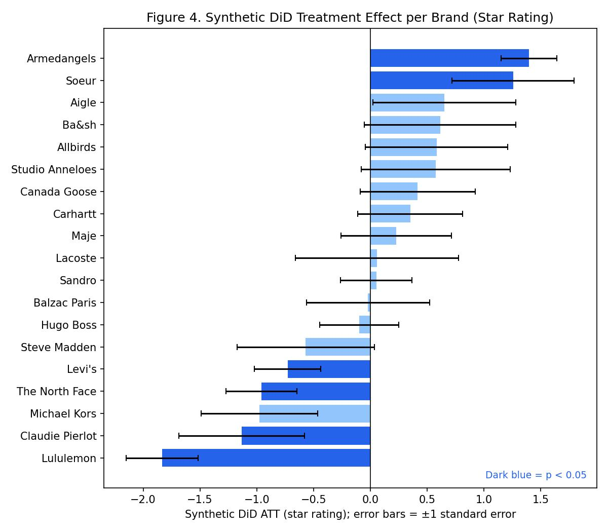

# Consumer Perceptions of Branded Resale Channels

**The Role of Design Features in Balancing Sustainability and Value**

Master thesis by Vera Gak Anagrova. MSc Economics and Business, Data Science and Marketing Analytics, Erasmus University Rotterdam, July 2026. Supervisor: Dr. Michiel Van Crombrugge.

The full thesis is in [`thesis/Master_Thesis_Vera_Gak_Anagrova.pdf`](thesis/Master_Thesis_Vera_Gak_Anagrova.pdf). This repository contains the data and code that produce every table and figure in it, plus a script that checks the reproduced numbers against the PDF.

## The question

More and more fashion brands sell their own second-hand products next to new ones: Sandro Seconde Main, Ba&sh Second Hand, Patagonia Worn Wear. The industry presents this as a low-risk sustainability signal. This thesis asks two questions:

1. When a brand launches its own resale channel, do customers see it differently afterwards, in their ratings, in how they talk about sustainability, and in how they talk about price and value?
2. Do the design choices of the resale channel explain why some brands gain and others lose? The four choices are how integrated it is with the main shop, how strongly it is framed as sustainability, how deep the discount is, and which extra services it offers.

## Data

49,736 unsolicited Trustpilot reviews of 48 fashion and outdoor brands, written between 2011 and 2026:

- **21 treatment brands** run their own resale programme, through Trove, Faume or Archive. 19 have enough reviews before the launch to be used.
- **27 control brands** are in the same segments but have no resale programme.

Each review gets three outcome measures:

- **Star rating**, from 1 to 5.
- **Sustainability score**: dictionary matches for terms like *recycle*, *circular* and *second-hand*, minus matches for greenwashing scepticism.
- **Value VADER**: sentiment of the sentences that talk about price, quality or value.

See [`data/README.md`](data/README.md) for the codebook. Review text is not published. Everything except the topic model can be reproduced without it.

## Method

| Study | Unit | Method | Thesis section |
|---|---|---|---|
| Preliminary | Review | LDA topic model, to check what reviews talk about | 4.3.1, 5.1 |
| Study 1 | Review for TWFE, brand x quarter for the others | Difference-in-differences with three estimators: TWFE, Callaway & Sant'Anna, and **synthetic DiD**, the main one | 4.3.2, 5.2 |
| Study 2 | Brand, N = 19 | OLS of each brand's synthetic DiD effect on the four design variables, HC1 standard errors | 4.3.3, 5.3 |

Synthetic DiD is the main estimator because the control brands start from a different baseline than the treatment brands. Before launch they have higher ratings and more sustainability talk. A plain DiD compares the two groups as they are. Synthetic DiD reweights the controls separately for each treatment brand, so they track that brand's own pre-launch path.

## Main findings

| Outcome | TWFE | Callaway & Sant'Anna | **Synthetic DiD** |
|---|---|---|---|
| Star rating | +0.244, p = 0.301 | -0.337, p = 0.225 | **-0.078, p = 0.419** |
| Sustainability score | +0.005, p = 0.822 | -0.014, p = 0.427 | **-0.018, p = 0.052** |
| Value VADER | +0.022, p = 0.680 | -0.052, p = 0.328 | **-0.103, p = 0.002** |

*Table 3 of the thesis. Average effect of a resale launch across the 19 treatment brands.*

- **All three synthetic DiD effects are negative.** The clearest one is in how customers write about price and value. Once the controls are reweighted, a positive, non-significant TWFE estimate becomes negative and significant.
- **Effects differ by segment.** Outdoor and athletic brands lose on all three outcomes. Contemporary fashion brands gain on rating but lose on sustainability language. Premium fashion gains on sustainability language. See Table 4.
- **Effects differ a lot by brand.** Rating effects range from -1.83 for Lululemon to +1.40 for Armedangels. See Figure 4 and Table 5.
- **Design choices do not explain the differences one by one.** With 19 brands, no design variable is significant in Table 6. One pattern holds: integration and sustainability messaging act as substitutes for sustainability perception. Their interaction is negative and significant in Table 7. The thesis treats this as suggestive.



## Where every result comes from

| Thesis | Script | Output in `results/` |
|---|---|---|
| Table 1: treatment sample | `code/10_descriptives.R` | `tables/table1_treatment_sample.csv` |
| Table 2: outcomes by group and period | `code/10_descriptives.R` | `tables/table2_descriptives.csv` |
| Figure 1: pre vs post outcomes | `code/11_figures_descriptive.py` | `figures/figure1_before_after.jpg` |
| Figure 2: LDA topics | `code/04_lda_topics.py`, needs review text | `figures/figure2_lda_topics.jpg` |
| Figure 3: rating by event time | `code/25_figures_synthdid.py` | `figures/figure3_event_time_rating.jpg` |
| Table 3: three estimators | `code/20`, `21`, `23`, `26` | `tables/tableA6_twfe.csv`, `table3_callaway_santanna.csv`, `table3_synthdid_pooled_thesis_se.csv` |
| Figure 4: synthetic DiD by brand | `code/23_synthdid.R` + `25_figures_synthdid.py` | `figures/figure4_synthdid_by_brand.jpg` |
| Figure 5: C&S event study | `code/22_cs_event_study.R` | `figures/figure5_cs_event_study_rating.jpg` |
| Figure 6: pre-launch fit | `code/23_synthdid.R` + `25_figures_synthdid.py` | `figures/figure6_pretrend_fit.jpg` |
| Table 4: synthetic DiD by segment | `code/23_synthdid.R` + `26` | `tables/table4_synthdid_by_segment_thesis_se.csv` |
| Table 5: brand-level changes | `code/31_study2_raw_change.R` | `tables/table5_brand_level.csv` |
| Table 6: moderation | `code/30_study2_moderation.R` | `tables/table6_moderation.csv` |
| Table 7: integration x messaging | `code/30_study2_moderation.R` | `tables/table7_interaction.csv` |
| Table A.1: control brands | `code/10_descriptives.R` | `tables/tableA1_control_brands.csv` |
| Tables A.4b and A.4c: LDA | `code/04_lda_topics.py` | `tables/tableA4b_lda_top_terms.csv`, `tableA4c_lda_topic_shares.csv` |
| Figure A.5: sustainability mentions | `code/11_figures_descriptive.py` | `figures/figureA5_sustainability_mentions.jpg` |
| Table A.6: full TWFE output | `code/20_twfe_did.R` | `tables/tableA6_twfe.csv` |
| Table A.7: without low-volume controls | `code/24_synthdid_lowvol.R` | `tables/tableA7_synthdid_excl_lowvol.csv` |
| Tables A.8a and A.8b: raw change scores | `code/31_study2_raw_change.R` | `tables/tableA8a_…`, `tableA8b_…` |

Tables A.2 and A.3 are inputs, not results. They are in `code/02_score_reviews.py` and `data/treatment_brands_moderators.csv`.

## Reproduce

Tested with R 4.5.1 (synthdid 0.0.9, did 2.3.1, lfe 3.1.1) and Python 3.11 (pandas 3.0, scikit-learn 1.8, matplotlib 3.10).

```bash
Rscript install_packages.R
pip install -r requirements.txt
bash run_all.sh     # about 2 hours, mostly the synthetic DiD; ends with the check against the thesis
```

`run_all.sh` runs the scripts in order. [`code/README.md`](code/README.md) explains each step and the three estimators.

## Verification

`code/99_check_against_thesis.py` compares each number printed in the thesis tables with the value the code produces. It writes [`results/verification_report.md`](results/verification_report.md).

| Result of 588 checks | Count |
|---|---|
| Match the thesis | 543 |
| Differ, with a known reason | 45 |
| Differ, unexplained | 0 |

The data preparation was checked as well. The scoring code in `code/02_score_reviews.py`, applied to the raw scraped reviews, reproduces the sustainability score and the value VADER score of all 49,736 reviews exactly. The LDA script reproduces Figure 2 and Table A.4 exactly from the review text.

The 543 matches include 23 numbers that depend on random resampling and agree within tolerance, and 3 p-values printed with a different convention. Each of the 45 differences is listed in the report with its reason, and they are summarised below.

## Notes and corrections

Rebuilding the analysis from scratch surfaced the points below where the PDF and the code differ. None of them change the main conclusions of Study 1 or Study 2. Point 3 changes how Appendix A.8 should be read.

1. **Synthetic DiD standard errors are random.** The per-brand effects are reproduced exactly. The placebo standard errors are random, and the thesis run had no fixed seed. Because Tables 3 and 4 average brands with weights 1/SE², the pooled numbers move with each run. `code/26_synthdid_pool_thesis_se.R` uses the standard errors saved from the thesis run and rebuilds Tables 3 and 4 exactly. A fresh run gives -0.063 (p = 0.48) for rating, -0.017 (p = 0.06) for sustainability, and -0.088 (p = 0.005) for value VADER. The signs and the significance pattern are the same. See `results/thesis_run/README.md`.
2. **Table A.7 is affected the same way.** A fresh run gives -0.135 (p = 0.14), -0.034 (p = 0.001) and -0.102 (p = 0.003). The thesis reports -0.167 (p = 0.079), -0.031 (p = 0.003) and -0.111 (p = 0.002). All effects are still negative, and sustainability and value stay significant. The thesis run did not save per-brand results for this check, so it cannot be rebuilt exactly.
3. **Tables A.8a and A.8b mix two runs.** Their discount rows and R² come from the final discount data, the ten-listing averages in Appendix A.3. The integration, messaging and services rows, and most of A.8b, come from an earlier run that used rough discount guesses. The code uses the final data throughout and matches the file the original script saved. With the final data, the integration x messaging interaction on raw rating change is -0.407 with p = 0.129, so it is **not significant**. The thesis reports p = 0.020. Appendix A.8 and the limitations section say the two outcome definitions point to different significant interactions. With the final data, the raw-change version finds no significant interaction, so the sensitivity check no longer contradicts the main result.
4. **Table 5 swaps two rows of raw changes.** The three Δ values of Ba&sh and Balzac Paris are swapped in the PDF. The data give Balzac Paris +1.912 stars and Ba&sh +1.812, which agrees with the thesis text: "Balzac Paris … its 1.9-star raw improvement". The synthetic DiD columns are correct.
5. **Table 2 has one typo.** The SD of the sustainability score for control brands after the event is 0.341, not 0.343.
6. **Table 6 p-values use the normal distribution, Table 7 uses the t distribution.** Three Table 6 cells use the t distribution. Coefficients and standard errors are identical either way. No conclusion changes. `results/tables/table6_moderation.csv` reports both.
7. **The "Within R²" in Table A.6 is the full R², including the fixed effects.** The true within R² is about 0.001. `tableA6_twfe.csv` reports both.
8. **The time axis of Figures 3 and 6 is in years.** It is labelled "quarters" in the thesis. The points are one quarter apart, so the axis running from -6 to 4 covers six years before launch and four after.
9. **Figure 4's error bars are ±1 standard error.** The thesis does not say what they show. A 95% interval would be about twice as wide.
10. **Figure 5 has one pre-launch point whose interval excludes zero.** At event time -3 the placebo estimate is 0.45 with a 95% interval of [0.06, 0.83]. The other two pre-launch points include zero. The thesis says no significant pre-treatment divergence remains. That holds for event times -2 and -1, not for -3.
11. **The LDA settings in Section 4.3.1 are not the ones the code used.** The thesis text describes 3,000 unigrams and bigrams, a minimum of 30 reviews and a maximum of 60%. The figure and Table A.4 were made with 1,000 single words, a minimum of 2 reviews and a maximum of 95%. The code is authoritative because it reproduces Table A.4 exactly.
12. **The sustainability dictionary in Appendix A.2 omits "natural".** The code's 38 patterns include it, and they split some stems into spelling variants, such as pre-owned and preowned. The thesis note on false positives mentions "natural".
13. **Discount depth uses ten listings per brand.** The Table A.3 note says five matched items, but the values are ten-listing means, as Section 4.2.2 states.
14. **An older comparison table was dropped.** An earlier hand-written Callaway & Sant'Anna average, in the original `table_cs_vs_twfe.csv`, averaged over all event times without a cap and gave wrong values. The thesis already used the `did` package estimates instead. That table is not included here.

## Repository layout

```
├── README.md                  this page
├── thesis/                    the thesis PDF
├── data/                      public data + codebook
├── code/                      numbered scripts, run in order (see code/README.md)
│   └── 01_data_collection/    Trustpilot scrapers
├── results/
│   ├── tables/                every table, as CSV
│   ├── figures/               every figure
│   └── verification_report.md
├── run_all.sh                 runs the whole pipeline
├── requirements.txt, install_packages.R
└── CITATION.cff, LICENSE
```

## Citation and licence

Code and data are released under the MIT licence. Please cite the thesis if you use them. See `CITATION.cff`.
